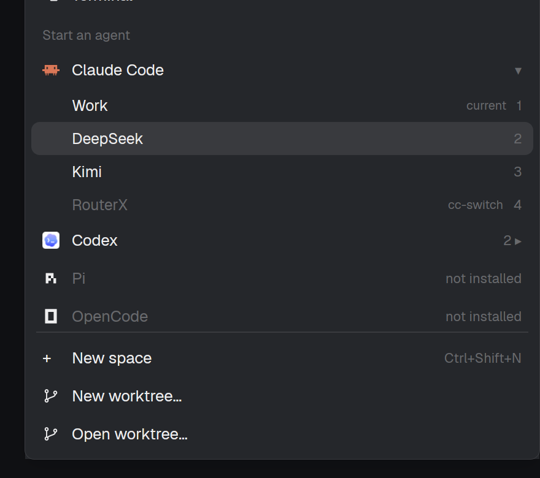
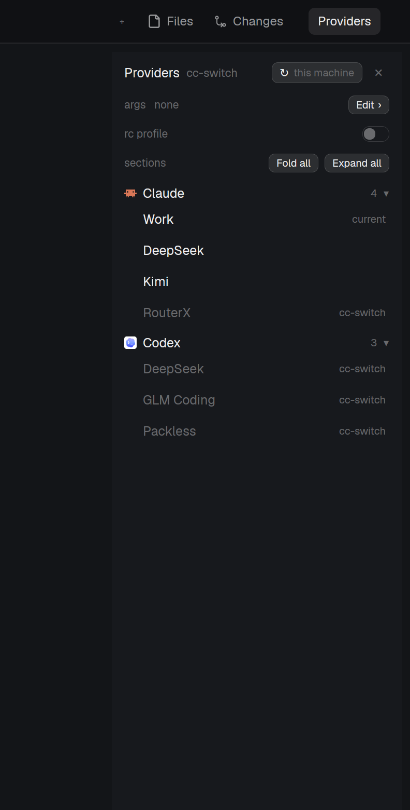

# herdr-provider-menu

**English** | [简体中文](README.zh-CN.md)

Start Claude Code and Codex in [Herdr](https://github.com/herdrdev/herdr-app) with a provider identity from cc-switch. Each terminal uses one provider. Terminals running side by side do not affect each other. The global configuration stays untouched. One terminal can run DeepSeek while the one next to it runs Kimi.

Claude Code and Codex are verified in the sandbox and on real machines (macOS and Linux), including cross-machine launches. Windows is not supported yet. [DESIGN.md](DESIGN.md) explains how the mod works, its decisions, and its security posture. [REVIEW.md](REVIEW.md) records the verification.





The repo holds two packages, each listed on herdr.dev/mods with its own recipe and preview: `agent-menu/` (the `+` popup, two mods) and `provider-menu/` (the docked panel).

## Requirements

- Herdr, the desktop app. This is a Herdr mod, not a standalone app.
- cc-switch, with providers configured in it. cc-switch stays the only place to edit providers. The mod only reads its database.
- sqlite3 on each machine that shows a provider menu. macOS ships it. On Linux run `sudo apt install sqlite3`.
- The CLIs themselves. Install `claude` and `codex` on the machines where they run.

## Install

Run this on the GUI machine, the machine that shows the Herdr window:

```sh
git clone https://github.com/maskshell/herdr-provider-menu && cd herdr-provider-menu
sh scripts/p1-install.sh    # mods in, a main clone named after you built, the panel docked (idempotent)
```

Then quit Herdr completely and open it again (the script switches you there when Herdr cannot be driven live). The tab-bar `+` opens the menu. The Claude Code and Codex rows expand into the cc-switch providers of that machine. Each entry is one explicit identity. The digit key on a row still starts the CLI as-is.

Installing from herdr.dev/mods instead of a checkout works too: copy each package's `mods/*` into `~/.config/herdr-app/mods/` (the recipe files describe the few extra steps, such as the `+` wiring and the panel's layout block).

### The side panel

The panel docks into personal layouts at 280px and gives:

- The cc-switch providers of each harness, in stacked sections that fold.
- A close ✕ in the header and a "Providers" pill in the tab bar: the panel hides and comes back, and the state survives restarts. A key can do the same without a tab-bar edit (`alt-p`; `cmd-shift-b` on macOS).
- An `args` row per machine: persistent extra parameters, for example `--allow-dangerously-skip-permissions`. The mod itself adds no parameter. The recorded row is the only way one enters a launch.
- An `rc profile` row per machine: run launches through the shell profile, so shell aliases and functions apply. Off by default.

The panel keeps the machine it last refreshed from. The refresh button shows the machine the shown lists came from and re-reads the active space's machine.

`p1-install.sh` installs it together with the menu, docks a `provider-menu-panel` block into every personal layout, and builds a clone of Herdr's shipped `main` named after you (`main-<username>`; full-width tab bar with the reopen pill, the panel beside the terminal-and-status column). No layout file ships in this repo and nothing is copied by hand. Want the menu only? Delete the block from your layout, or hide it: `layout.toggle {id: "provider-menu-panel"}` (a personal keybinding can carry the command, for example `"alt-p": "layout.toggle:provider-menu-panel"` — on macOS use `cmd-shift-b`; `alt` is the option key there and ⌥P types π).

The rc mode turns the launch into a command string under `bash -[l]ic`. The profile runs first, so aliases and functions both apply. A plain launch runs the argv directly, without a shell parse; aliases never expand there. Parameters and dynamic environment variables can therefore live in the profile instead of this mod. For example, either form works:

```sh
alias claude='workspaceFolder="$(pwd)" command claude --dangerously-skip-permissions'

claude() {
  workspaceFolder="$(pwd)" command claude --dangerously-skip-permissions "$@"
}
```

(`command` keeps the alias or the function from calling itself.)

### Headless machines

A headless machine runs only core and the CLIs. Install nothing on it. The menu reads that machine's own `~/.cc-switch/cc-switch.db` when it opens. Bringing the database to that machine is the user's job. Use cc-switch's own sync, WebDAV, or configure the providers from a machine with the cc-switch GUI.

A headless machine can also run without its own database. Refresh the panel while the GUI machine's space is active, switch to the headless space, and click a provider there. The identity travels inside the launch command. The panel keeps the machine it last refreshed from; launches land in the active space. To use the headless machine's own database, switch to its space and refresh.

## Update

```sh
git pull
sh scripts/p1-install.sh
```

After a Herdr update this is enough for the menu, the panel and your clone layout: the script creates your clone **once** (`main-<username>`; an earlier `main-providers` is renamed to it, tweaks kept) and from then on treats it as yours — your edits survive re-runs; refresh it by deleting the file and re-running (the same contract as the my-tabs fork). Layouts with their own look (a win98 clone, say) are skipped: the panel targets the main window. It never touches Herdr's own layout files (an edited shipped file is moved aside by the app as `<name>-edited(-N)` copies). `my-tabs` is a fork of the shipped tab bar, so stock tab-bar changes do not appear in it until the fork is refreshed: re-clone `tabs` as `my-tabs`, re-apply the one-line `+` change (see [agent-menu/RECIPE.md](agent-menu/RECIPE.md)), run the script again, restart Herdr.

## Uninstall

```sh
rm -rf ~/.config/herdr-app/mods/agent-menu ~/.config/herdr-app/mods/my-tabs ~/.config/herdr-app/mods/provider-menu
herdr-app do layout.switch '{"name":"main"}'
```

These commands return to the shipped layout. Delete the personal layout file under `~/.config/herdr-app/layouts/` when it is no longer wanted. The recorded `args` and `rc profile` values stay in Herdr's shared state. They do nothing once the mods are gone. If the keyboard form was installed, also remove the `alt-p` binding (`cmd-shift-b` on macOS; the `layout:<name>` section) from `~/.config/herdr-app/keys.json`. A personal layout kept on disk still carries the panel and toggle blocks and its wrapped tab bar; delete the file, or remove those two nodes and unwrap the tab bar, to clean it fully.

## Limits

- Windows is not supported as the GUI machine or as a launch target yet: the launch commands use `env`, `bash`, and `/dev/shm` (Windows recipes are the pending T3); launching from a Windows space shows an explanation dialog. A Windows machine works as a database source — reading its cc-switch.db only needs sqlite3 there.
- Some providers work only through cc-switch itself: official OAuth accounts, and formats that need the local router. They appear grey, with the reason. The mod never launches them.
- The mod never adds `--dangerously-skip-permissions` or any other flag by itself. A flag enters a launch only through the recorded `args` row.
- Credentials reach the CLI through a RAM-only handoff where the machine allows it: an exec plants the secret in a 0600 file under `/dev/shm`, the terminal command only reads that path and deletes the file at once, and nothing lands on disk or in the recorded command. Machines without `/dev/shm` (macOS) fall back to the credential riding in the launch command itself. There, herdr's core records the command — including the credential — in its state file `~/.local/state/herdr-core/<session>/terminals.json`, with no automatic cleanup, and a first cross-machine launch asks for confirmation per machine pair. Live sessions show the fallback command in `/proc`. DESIGN.md §6 has the details.
- Environment keys that exist only in the live settings file (`~/.claude/settings.json`) are blocked on each launch. Put tuning keys such as `CLAUDE_CODE_*` on each provider in cc-switch, not only in the live file.
- On a headless machine the database is the user's job. `scripts/seed-cc-switch-db.py` is a verification tool, not a provisioning path.

## Further reading

- [README.zh-CN.md](README.zh-CN.md), the same manual in Chinese.
- [agent-menu/RECIPE.md](agent-menu/RECIPE.md) and [provider-menu/RECIPE.md](provider-menu/RECIPE.md): the two packages as they appear on herdr.dev/mods.
- [DESIGN.md](DESIGN.md): architecture, launch recipes, security, tests, and the scripts reference.
- [REVIEW.md](REVIEW.md): the verification log. The evidence sits in `evidence/`.
- [LICENSE](LICENSE), MIT.
