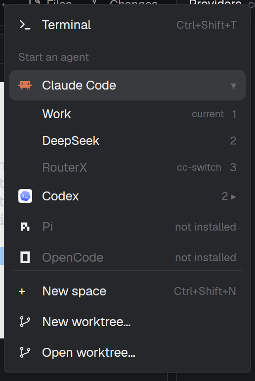
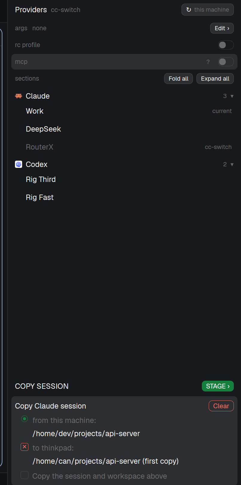

# herdr-provider-menu

[English](README.md) | **简体中文**

在 [Herdr](https://github.com/herdrdev/herdr-app) 里以 [cc-switch](https://github.com/farion1231/cc-switch) 管理的供应商身份启动 Claude Code 与 Codex。每个终端使用一个供应商。并行终端互不影响。全局配置保持不变。一个终端用 DeepSeek，旁边的终端用 Kimi，都可以。会话也可以连同工作区复制到另一台机器(可再生目录留下)，在那里以该 harness 中本 mod 可启动的任意供应商身份恢复。

Claude Code 与 Codex 已在 sandbox 与真机(macOS、Linux)验证，含跨机启动。会话复制已在真机端到端验证(Claude Code)；codex 侧经 rig 验证，其 resume 参数与 codex 0.172.0 的文档形态一致(`resume <id> <prompt>`)；真机回合仍待。Windows 暂不支持。[DESIGN.md](DESIGN.md) 说明工作原理、设计决策与安全姿态；[REVIEW.md](REVIEW.md) 记录验证过程。

<p></p>

<p></p>

仓库含两个包，各自以独立条目(附配方与预览图)列于 herdr.dev/mods：`agent-menu/`(+ 弹窗，两个 mod)与 `provider-menu/`(停靠面板)。

## 依赖

- Herdr 桌面应用。这是一个 Herdr mod，不是独立应用。
- cc-switch，并在其中配好供应商。cc-switch 仍是编辑供应商的唯一入口。本 mod 只读它的数据库。
- 每台显示供应商菜单的机器装有 sqlite3。macOS 自带。Linux 上执行 `sudo apt install sqlite3`。
- CLI 本体。`claude` 与 `codex` 装在它们运行的机器上。

## 安装

在 GUI 机上执行，即显示 Herdr 窗口的机器：

```sh
git clone https://github.com/maskshell/herdr-provider-menu && cd herdr-provider-menu
sh scripts/p1-install.sh    # 装入 mod、生成以你命名的 main 克隆、停靠面板(幂等)
```

然后完全退出 Herdr 并重开(脚本在无法活切时会安排下次启动切换)。标签栏 `+` 打开菜单。Claude Code 行与 Codex 行各自展开该机的 cc-switch 供应商。每一条是一个显式身份。行上的数字键仍按原样启动 CLI。

不经 checkout、直接从 herdr.dev/mods 安装也可以：把各包的 `mods/*` 复制进 `~/.config/herdr-app/mods/`(配方文件说明了少数额外步骤，例如 `+` 按钮的接线和面板的布局块)。

### 侧栏面板

面板以 280px 停靠进个人布局，提供：

- 各 harness 的 cc-switch 供应商列表，按堆叠区块分组，可折叠。
- 头部的关闭 ✕ 与 tab 栏的 “Providers” 重开钮：面板可收起、可复原，状态重启后保留。键位同样可开合(`alt-p`；macOS 为 `cmd-shift-b`——那里的 alt 是 option 键，⌥P 会打出 π)。
- 每机一个 `args` 行：持久附加参数，例如 `--allow-dangerously-skip-permissions`。本 mod 自身不添加任何参数。参数进入启动的唯一途径是这个被记录的行。
- 每机一个 `rc profile` 行：经 shell profile 运行启动，shell 的 alias 与 function 因此生效。默认关闭。
- 每机一个 `mcp` 行：跨机启动时把本机为该 agent 勾选的 cc-switch MCP 一并带去(Claude 与 Codex 各自的集合；`only mine` 让该会话只用携带集)。同机启动不带——本机的 cc-switch 已把它们写进 live 配置。
- 面板最底一行 `COPY SESSION  STAGE ›`：暂存聚焦中的 Claude Code 或 Codex 会话，把会话的工作区复制(或增量更新)到另一台机器上的一个目录(可再生目录留下)，并在那里以该 harness 中本 mod 可启动的任意供应商身份恢复。

面板记住上次刷新所用的机器。刷新按钮显示所示列表的来源机器，并按当前 space 的机器重读。

Codex 供应商也能在 live `config.toml` 带有 cc-switch 目录指针(`model_catalog_json`)的机器上启动：启动器为该供应商钉死的模型现场合成单模型目录，在终端拉起前写入 `$TMPDIR`，以 `-c model_catalog_json` 指向它。探针成功时，官方模型名镜像启动目标机自己的 `codex debug models --bundled` 条目并施加 cc-switch 对第三方端点的改写；其余情形——未知的名字或探针失败——用一份中性模板条目，发生了什么面板会说明。所示列表来源机的 current 供应商、且启动落在同一台机器时，完全跳过 live 检查——与 cc-switch 自己的启动终端同等待遇。该同机直启之外，仍然拒绝——不限于：选中了 cc-switch profile 的供应商、带 `model_auto_compact_token_limit` 覆盖的，以及(仅跨机)自带目录指针的供应商——该路径在目标机会悬空。(已在沙箱对真 codex 0.172.0 验证；真机轮次在后。)

`p1-install.sh` 把它与菜单一并安装，在每个个人布局里停靠一个 `provider-menu-panel` 块，并从 Herdr 自带的出厂 `main` 克隆一份以你命名的布局(`main-<用户名>`；满宽 tab 栏带重开钮，面板与「终端+状态栏」整组平行)。仓库不带布局文件，也不需要手动拷贝任何 JSON。同一个开合命令也绑在键位上(`alt-p`；macOS 为 `cmd-shift-b`)，绑进面板停靠的每个布局；Herdr 对键位文件是活重载。只想要菜单？从布局里删掉该块，或用键位或 `layout.toggle {id: "provider-menu-panel"}` 隐藏。

rc 模式把启动改为经 `bash -[l]ic` 执行的命令串：profile 先运行，alias 与 function 都会生效。普通启动不经 shell 解析，alias 从不展开。参数与动态环境变量因此可以放进 profile，而不必依赖本 mod。例如，两种写法都可以：

```sh
alias claude='workspaceFolder="$(pwd)" command claude --allow-dangerously-skip-permissions'

claude() {
  workspaceFolder="$(pwd)" command claude --allow-dangerously-skip-permissions "$@"
}
```

(`command` 防止 alias 或函数递归调用自身。)

### 复制会话到另一台机器

面板底部的这一行把聚焦中的 agent 会话送上复制之路(同机复制同样可行)：

1. 聚焦一个 Claude Code 或 Codex 终端，点 `STAGE ›`。卡片标出来源机器与会话的工作区。
2. 切到目标机器的 space，在那里开一个 shell，`cd` 进一个空目录(首次复制)或上次复制得到的目录(增量更新)。
3. 在卡片的列表里选中该目录，勾上复选框(更新目标上它写作 `Update the session and workspace above`)，点同一 harness 的一个供应商。工作区作为经校验的快照过境，面向项目级而非 monorepo 体量——可再生目录(`node_modules`、`target`、`.venv` 等)留下、按需重装，其余常规文件全部随行，含 `.env` 与凭据(v1 跳过符号链接；确认弹窗会写明随行内容)——transcript 落在目标机的 CLI 会找到的位置，会话以所点供应商的身份恢复；确认弹窗里可编辑首条消息。
4. 随后的模态窗裁决源端去向：保留(可能与副本分叉)或停掉它的标签。按 Esc 视同保留。

一次复制后两端各带一个 `.herdr-migrated` 标记——源端工作区也会得到一个。此后向目标端的复制走增量、含删除；目标端自己的改动会在下一次复制中被覆盖(目标位=停车位，设计如此)，漂移在运行前点数提醒，传输完成后目标端全量复哈希校验。`Cancel` 中止运行并清扫两端临时打包文件——首次复制中途停止会让目标保持无标记，重试前须清空，中断的增量更新则可直接重试；卡片的红色 `Clear` 则丢弃暂存本身。

### 无头机

无头机只运行 core 与 CLI。无头机上不需要安装。菜单打开时读取该机自己的 `~/.cc-switch/cc-switch.db`。把数据库带到该机由用户自行解决。用 cc-switch 自带的同步(WebDAV)，或在装有 cc-switch GUI 的机器上配置。

无头机也可以没有自己的数据库。在 GUI 机的 space 里刷新面板，切到无头机的 space，在那里点击供应商即可。身份随启动命令本身传递。面板记住上次刷新所用的机器；启动落在当前 space。要用无头机自己的数据库，切到它的 space 再刷新。

## 更新

```sh
git pull
sh scripts/p1-install.sh
```

Herdr 升级后，这样对菜单、面板、你的克隆布局与开合键位就已足够：脚本**创建一次**你的克隆(`main-<用户名>`；旧的 `main-providers` 会改名迁移、微调保留)，此后视为你的文件——改动在重跑后保留，想刷新就删掉再跑(与 my-tabs 分叉同款契约)。带独立外观的布局(如 win98 克隆)会被跳过：面板以默认窗口为目标。脚本绝不触碰 Herdr 自己的布局文件(出厂文件一旦被改，app 下次启动会把它搬成 `<name>-edited(-N)` 副本)。`my-tabs` 是出厂标签栏的分叉，出厂标签栏的改动要等分叉刷新才会出现：把 `tabs` 重新克隆为 `my-tabs`，重打那一行 `+` 接线(见 [agent-menu/RECIPE.md](agent-menu/RECIPE.md))，再执行脚本并重启 Herdr。

## 卸载

```sh
rm -rf ~/.config/herdr-app/mods/agent-menu ~/.config/herdr-app/mods/my-tabs ~/.config/herdr-app/mods/provider-menu
herdr-app do layout.switch '{"name":"main"}'
```

以上命令执行后回到出厂布局。不需要的个人布局文件(`~/.config/herdr-app/layouts/` 下)可以删除。记录过的 `args` 与 `rc profile` 值留在 Herdr 共享状态里。mod 移除后它们不再起作用。脚本加进 `~/.config/herdr-app/keys.json` 的 `alt-p` 绑定(macOS 为 `cmd-shift-b`；`layout:<名字>` 段)也一并移除。保留在磁盘上的个人布局仍带面板块与重开钮块，tab 栏也仍是包过的；删掉该文件，或移除这两个节点并把 tab 栏解包，才算清理干净。

## 制约

- Windows 暂不支持作为 GUI 机或启动目标：启动命令使用 `env`、`bash` 与 `/dev/shm`（Windows 配方待做）；从 Windows space 启动会显示解释弹窗。Windows 机器可以作为数据库源——读取它的 cc-switch.db 只需要那台机器装有 sqlite3。
- 某些供应商只能经 cc-switch 本身运行：官方 OAuth 账号，以及需要本地路由的格式。它们灰显并注明原因。本 mod 不启动它们。
- 本 mod 绝不自行添加 `--dangerously-skip-permissions` 或任何其他参数。参数只能经用户记录的 `args` 行进入启动。
- 凭据经内存交接送达 CLI（机器支持时）：一次 exec 把凭据写入 `/dev/shm` 下的 0600 文件，终端命令只读取该路径并随即删除文件——不落盘，也不进被记录的启动命令。无 `/dev/shm` 的机器（macOS）回落为凭据随启动命令本身传递：此时目标机上的 herdr core 会把启动命令（含凭据）记录进状态文件 `~/.local/state/herdr-core/<会话>/terminals.json`，且无自动清理；跨机借用的首次启动会按机器对弹窗确认。回落形态下，活会话期间命令也出现在 `/proc` 里。细节见 DESIGN.md §6。
- 仅存在于 live 设置文件(`~/.claude/settings.json`)里的环境变量键会被逐次启动挡掉。`CLAUDE_CODE_*` 等调优键应配在各供应商上(cc-switch 里)，而不是只写在 live 文件里。
- 携带的 MCP 定义 env 里可含 token。它们与凭据走同一内存交接；无 /dev/shm 的机器上随启动命令传递(跨机弹窗先确认)，且定义在启动进程存活期间停留在其命令行上。在目标机上携带集与该机自有定义合并——同名时携带的定义在该会话胜出。
- 会话复制把工作区文件写到目标机磁盘——含 `.env` 与凭据；确认弹窗在运行前写明。上述启动凭据通道不覆盖工作区内容，且传输分块搭乘 exec 命令行——复制运行期间，文件内容会短暂出现在接收机的进程列表里。
- 无头机上，数据库由用户自行解决。`scripts/seed-cc-switch-db.py` 是验证工具，不是建库方式。

## 延伸阅读

- [README.md](README.md)，英文主版本。
- [agent-menu/RECIPE.md](agent-menu/RECIPE.md)与[provider-menu/RECIPE.md](provider-menu/RECIPE.md)：两个包在 herdr.dev/mods 上的条目内容。
- [DESIGN.md](DESIGN.md)：架构、启动配方、安全、测试与 scripts 说明。
- [REVIEW.md](REVIEW.md)：验证记录。证据在 `evidence/`。
- [LICENSE](LICENSE)，MIT。
