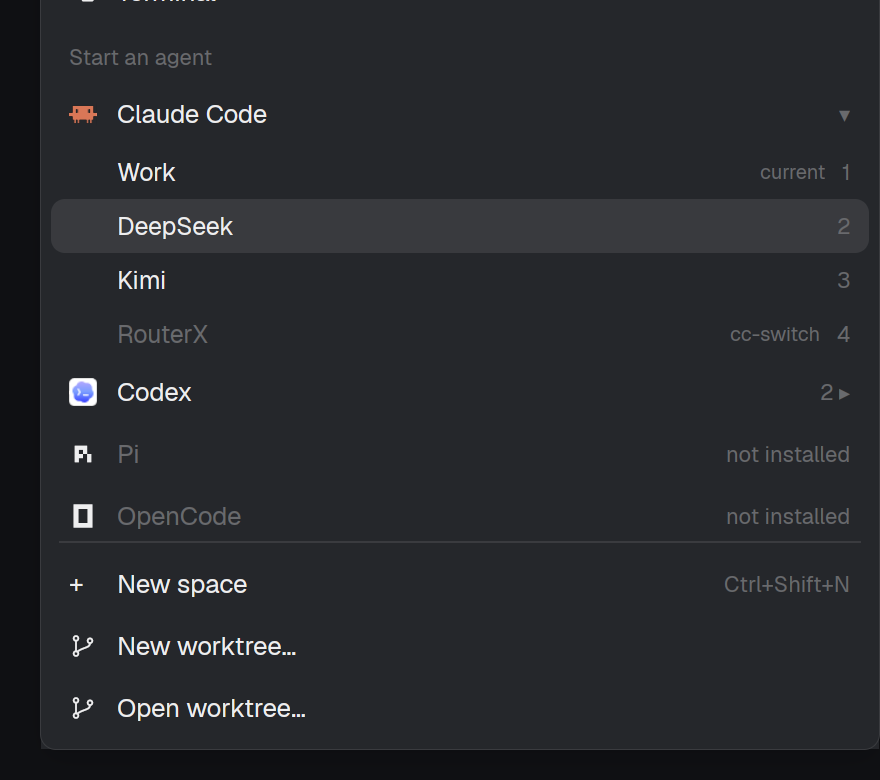

# Agent menu with cc-switch identities

The tab bar's + opens the usual start menu, but the Claude Code and Codex rows each expand into the cc-switch provider cards on this machine. Picking a card starts the agent in a new tab under that identity, with the card's environment applied to that one launch — nothing is switched in cc-switch and nothing on disk changes. The plain launch (top-level digit) still starts the agent exactly as the stock menu does.

## What you see

A 250px popup over a dimmed window, the stock new-menu look: a Terminal row with its shortcut hint, the dim label "Start an agent" (11px), then agent rows 31px tall — icon, name, hint on the right. Plain agents show their digit; the harness rows (Claude Code, Codex) show `1 ▸` / `2 ▸`, which turns to `▾` while expanded. Up to two not-installed agents appear dim with "not installed". A 1px divider, then New space, New worktree…, Open worktree….

Expanding a harness grows the popup and appends indented 27px rows — this machine's cc-switch cards for that agent: card name, a 10px "current" tag on cc-switch's current card, digit hints 1-9. Cards the launcher cannot rebuild per-launch (official OAuth, routed contracts, keyless codex cards) render dim with a "cc-switch" tag instead.

## How it behaves

- Clicking a harness row toggles its submenu; one open at a time — clicking another harness swaps in the same click.
- The card list is read when the submenu opens (not when the popup opens), from the active space's machine through `sqlite3` over Herdr's machine link; "Reading cc-switch…" shows meanwhile.
- Click a launchable card: the popup closes and a tab opens named `Claude Code (Work)` — argv built from the card (environment cleaned with `env -u`, the card's `ANTHROPIC_*` applied; codex cards carry auth + config.toml; the credential goes by /dev/shm RAM handoff when the machine has it). Click a dim card: the menu stays and a note under the rows says why cc-switch itself must switch that one.
- Digits scope to the open layer: 1-9 at the top level launch the plain agent; with a submenu open they pick that card. Esc retreats one layer (submenu closes; the next Esc dismisses the popup).
- Failures are honest rows, never silence: no `sqlite3` on the machine, no `~/.cc-switch/cc-switch.db`, and a read error each get their own sentence.

## Built from

Two mods in this package, both clones of shipped mods:

- `agent-menu` — a clone of the shipped `new-menu` (`place: "none"`), differing as described above. From `herdr`: `theme, spaces, panes, knownAgents, run, openOverlay, closeOverlay, props, window, keys, shared, setShared`; from gpui: `View, div, svg, image, h_flex, v_flex`. Calls `run("tab.new", { name, space, argv })`, `run("space.new")`, opens the worktree dialogs. Height is computed: `min(491, 167 + rows*31 + submenu*27)`.
- `my-tabs` — a clone of the shipped `tabs` with one changed line: the + button runs `openOverlay({ mod: "agent-menu", kind: "popup", width: 250, height: 512 })` instead of opening the stock menu. Everything else in the tab bar is stock.
- Both carry the same `providers.js`: reads the space machine's `~/.cc-switch/cc-switch.db` read-only via the `sqlite3` CLI, classifies each card per harness (`HARNESS = { claude, codex }`), and builds launch argv. Exports `readProviders, launchArgv, cardNote, handoffAvailable, readMcps`. Extra args and rc-profile mode (set through the provider-menu panel package) are honored here too. MCP carry-over does not apply here: this menu always reads the machine it launches on, so there is nothing to carry across.
- Icons: `icons/shell.svg`, `mods/workspace-chrome/branch.svg`, agent icons from `knownAgents()`.

## Watch out

- Install both mods. Without `my-tabs`, the + button opens the stock menu and nothing opens `agent-menu` — no keybinding ships for it.
- `my-tabs` is a fork of the shipped `tabs`: when an app update changes the stock tab bar, this fork keeps the old look until re-cloned and re-patched (the one-line diff above is the whole change).
- A harness that is not installed renders as a plain dim row and does not expand; install the CLI first.
- Digits cover only the first nine cards; more cards still click.
- The read goes through the active space's machine: a remote space without `sqlite3` or a cc-switch database shows the failure rows, not this machine's cards.
- Cards come from cc-switch's database only. To add one, add it in cc-switch and reopen the submenu.

## Done when

- + opens the popup; the Claude Code row shows `1 ▸`; clicking it lists this machine's cc-switch cards with digits, the current card tagged "current".
- Pressing 2 with Claude Code expanded opens a tab named `Claude Code (<card 2>)` whose process carries that card's `ANTHROPIC_BASE_URL` (a stub CLI dumping argv/env proves it).
- Esc collapses the submenu; the next Esc closes the popup; 1 with no submenu open starts plain Claude Code.
- On a machine with no `~/.cc-switch/cc-switch.db`, the submenu says so instead of listing nothing.
- The stock rows still work: Terminal, New space, both worktree dialogs, and the tab bar's right-click menu.
