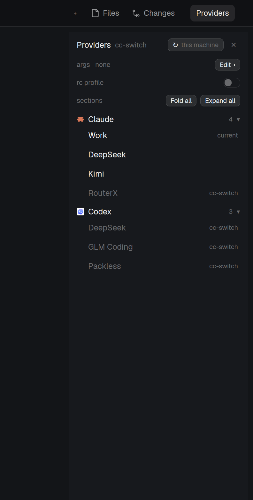

# Provider menu panel (cc-switch, docked)

A 280px panel docked to the right of a layout: every cc-switch provider card on this machine, grouped by agent (Claude, Codex). Click a card to start that agent in a new tab under that identity, with the card's environment applied to that one launch — nothing is switched in cc-switch and nothing on disk changes.

## What you see

Top to bottom on `t.surface`, 12.5px base text:

- Header: bold "Providers", dim "cc-switch", a bordered refresh chip labeled with the machine the shown lists came from ("this machine" or a machine name, truncated with … past 12 chars), and a ✕ that hides the panel.
- `args` row: the extra launch arguments recorded for this machine ("none" until set) and an "Edit ›" chip.
- `rc profile` row with a 26×15 switch pill — off by default (bordered track, knob left), on = accent track, knob right.
- `sections` row: "Fold all" and "Expand all" chips.
- One section per agent: a 20px header (12px icon, bold title, card count, ▾/▸) over 30px cards indented to align with the title — name, and a 10px "current" tag on cc-switch's current card. Cards the launcher cannot rebuild per-launch (official OAuth, routed contracts, keyless codex cards) render dim with a "cc-switch" tag.
- The sections scroll; the fold state and every setting persist across restarts.

## How it behaves

- Click a launchable card: a tab named `Claude Code (Work)` starts with argv built from the card — environment cleaned with `env -u`, the card's `ANTHROPIC_*` applied (token, base URL, model overrides, headers); codex cards carry auth + config.toml. When the machine has /dev/shm the credential travels by RAM handoff (a read-then-delete file, so the command line stays clean); otherwise it rides the argv. Click a dim card: a note at the panel bottom says why cc-switch itself must switch that one.
- Cross-machine: switch to a space on another machine and the lists stay from wherever they were last read — the refresh chip names that source. Launching a card from one machine's list into another machine's space asks once per source→target pair, with a dialog spelling out where the credential lands (the target core's terminals.json record, /proc while live); pairs where the target has /dev/shm skip the ask. "Always for this pair" remembers consent.
- A Windows-target space cannot take provider launches yet: a dialog says so; reading databases and plain launches still work.
- `Edit` opens a dialog for per-machine extra args (shell-style words, quotes group, empty = none). The mod never adds arguments itself — this row is the only place they enter, and they show here and in the launch argv.
- `rc profile` on: the launch becomes a `bash -lic` command string, so shell aliases and functions apply. Off: plain word-vector launch.
- The refresh chip re-reads the database. The last good read is cached, so the panel opens instantly and re-checks below. Failures are honest sentences with a way out: sqlite3 missing (with the per-OS install command), database not found (add a provider in cc-switch first), or the read error itself.
- The header's ✕ hides the panel; a "Providers" pill beside the tab bar (the toggle block below) brings it back. Open/closed is the layout's own state, so it survives restarts, and the panel re-reads the database when it comes back. The pill composes with other mods' toggles: tested side by side with skillshare's button, each panel opens and closes its own column without touching the other.

## Built from

- `mods/provider-menu` — `mod.json { "place": "right", "size": 280 }`. Docking is a layout edit; no layout ships in this package. Clone a layout of yours and add the panel block to a row: `{"id": "provider-menu-panel", "type": "block", "size": {"px": 280}, "content": {"mod": "provider-menu"}}`. Then wrap the tab-bar block in a row and add the reopen pill beside it: `{"type": "block", "size": {"px": 104}, "content": {"mod": "provider-menu", "props": {"role": "toggle"}}}`. The two nodes go together: the ✕ is drawn only when a toggle block exists, so a panel closed by mistake always has a visible way back.
- Keyboard alternative, no tab-bar edit: keep the panel block (with its `provider-menu-panel` id) and merge this package's `keys.json` instead of wrapping the tab bar — `alt-p` then shows and hides the panel. Rename the `layout:…` section to the person's layout name (the installer script names its main clone `main-<username>`) (a binding in `global` fires in every layout and toasts "no node" wherever the panel isn't docked). On macOS, replace the key with `cmd-shift-b`: `alt` is the option key there, ⌥P types π, and Herdr's own key guide says not to bind option+letters; the shipped mac table has no `alt-*` at all, and `cmd-shift-b` sits free beside the app's own `cmd-b` sidebar binding. In this form the key is both directions: no ✕ is drawn, the key closes and reopens.
- The ✕ and the pill find the panel's own node in the shown layout (the `layout()` read, matched by `content.mod`), then `run("layout.hide", …)` / `run("layout.toggle", …)`. No node id is needed for them: they work for a hand-added block and for the app's first-seen auto-dock alike. The `provider-menu-panel` id in the block above serves only the shipped key binding, which needs a fixed id (`layout.toggle:provider-menu-panel`, the same shape as the app's own `ctrl-shift-b` sidebar binding). From `herdr`: `theme, spaces, run, shared, setShared, window, checking, props, openOverlay, closeOverlay, knownAgents, layout`; from gpui: `View, div, svg, image, h_flex, v_flex, InputState, Input`. Calls `run("tab.new", { name, space, argv })`.
- `providers.js` (identical to the agent-menu package's copy): reads the space machine's `~/.cc-switch/cc-switch.db` read-only via the `sqlite3` CLI, classifies each card per harness (`HARNESS = { claude, codex }`), builds launch argv, probes the /dev/shm handoff. Exports `readProviders, launchArgv, cardNote, handoffAvailable, EXTRA, RC`.
- Three dialog modes through `props().mode`: `args` (520×236), `borrow` (560×310), `windows` (520×250). Persistence via `shared()`: `provider-menu.<app>` read caches, `provider-menu.extraArgs`, `provider-menu.rcLaunch`, `provider-menu.fold`, `provider-menu.src`, `provider-menu.borrowOk`, plus `new-menu.agents` shared with the stock menu.

## Watch out

- Docking needs that one-line layout edit; without a layout block the mod installs but never shows. Dock it as its own block or column, not inside the per-space Files/Changes stack — a space switch restores that stack and closes it again. A layout with the panel but no toggle block shows no ✕ (the pill is the way back); recover a hidden panel without one from a terminal: `herdr-app do layout.show '{"id":"<panel node id>"}'`.
- Windows is read-only: cards list, launches are gated with the dialog (the Windows recipes are not built).
- The cross-machine consent matters: the fallback argv persists the credential in the target machine's terminals.json and nothing cleans it. Read the dialog before choosing "Always for this pair".
- `sqlite3` must exist on the machine whose database is read (macOS: built in; Linux: `sudo apt install sqlite3`; Windows: `winget install SQLite.SQLite`).
- Extra args and rc mode apply to launches from both this panel and the agent-menu package's submenu — they are one setting set from two places.
- Cards come from cc-switch's database only: add or remove providers in cc-switch, then ↻.

## Done when

- Docked in a layout, the panel lists this machine's cards grouped Claude/Codex, cc-switch's current card tagged "current".
- Clicking a card opens a tab named `Claude Code (<card>)` whose process carries the card's `ANTHROPIC_BASE_URL` and token (a stub CLI dumping argv/env proves it).
- `Edit` saves `--flag x`, the row shows it, and the next launch's argv carries it; rc profile on makes the launch `bash -lic …`.
- Folding sections, then restarting Herdr, keeps the fold; the refresh chip names the source machine after a read in a remote space.
- The header's ✕ hides the panel, the tab-bar pill brings it back, and a restart leaves the panel where it was left (open or closed).
- With sqlite3 removed from PATH, the panel prints the install hint instead of an empty list.
